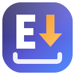
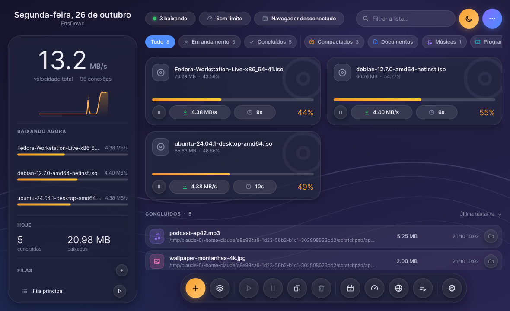
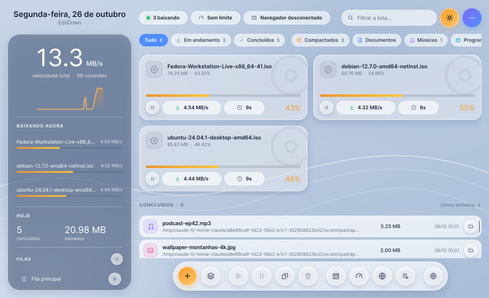
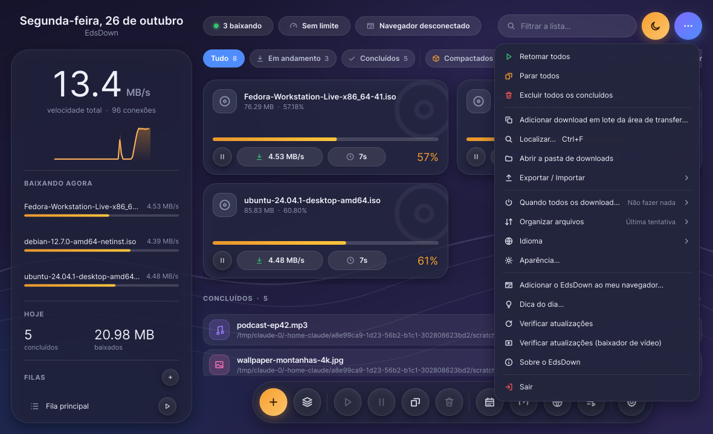
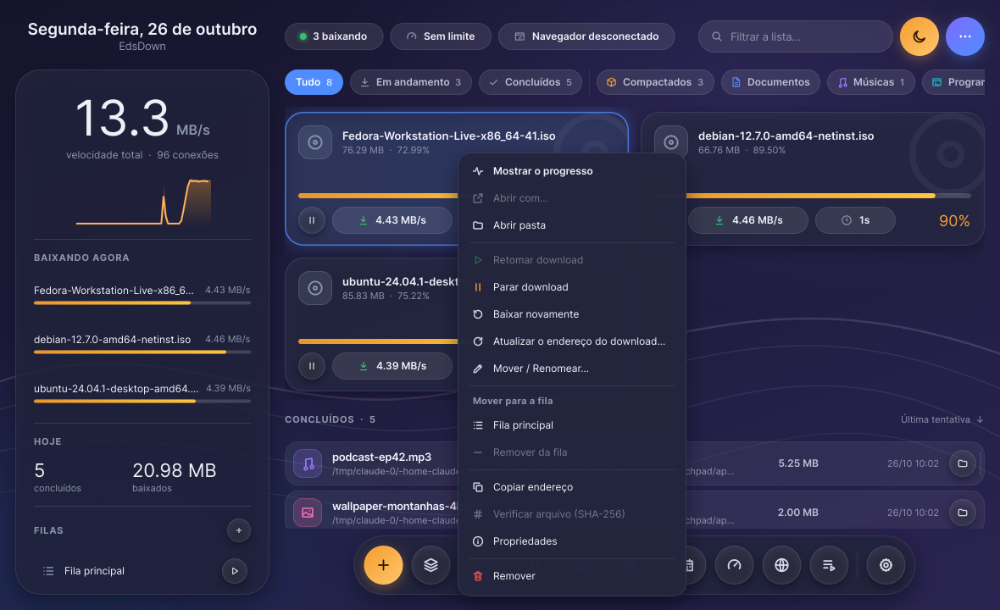
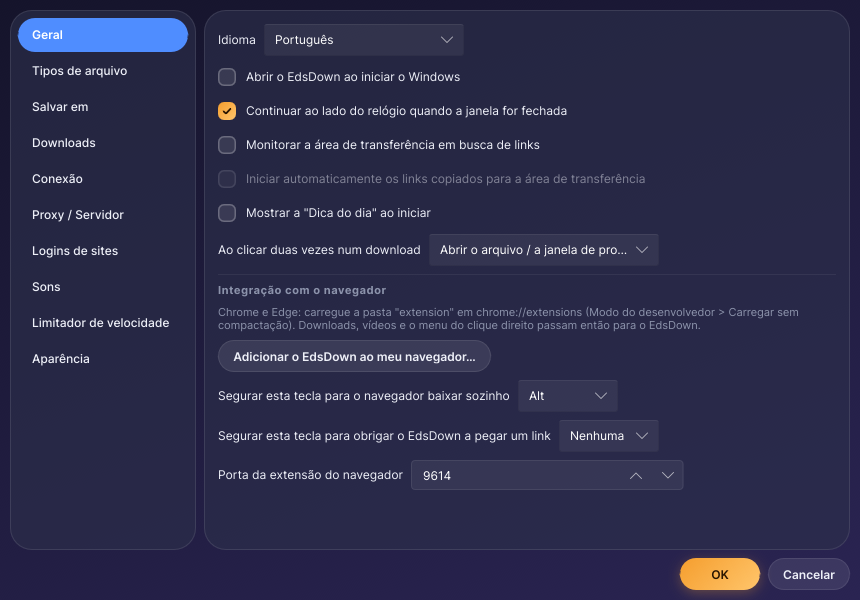
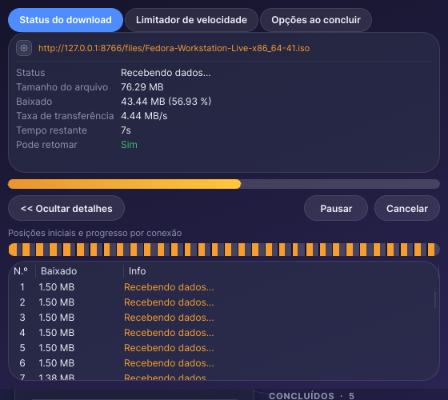
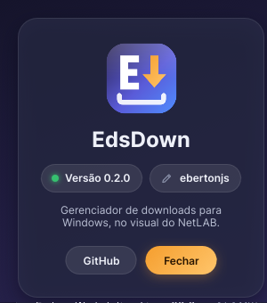
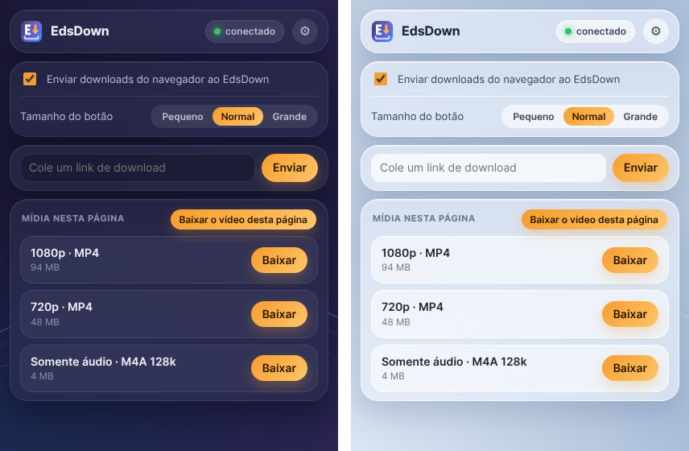
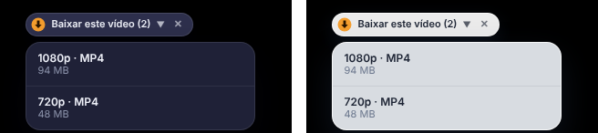

<div align="center">



# EdsDown

Gerenciador de downloads para Windows, escrito em Rust.


[](https://github.com/ebertonjs/edsdown/releases/latest)

<br>



</div>

---

## Telas

Interface no layout do **NetLAB**: coluna lateral com a velocidade total e o gráfico do último minuto, pílulas de status no topo, downloads em andamento como cards de vidro, concluídos em linhas compactas e um dock flutuante de botões redondos. Temas **NetLAB escuro** e **NetLAB claro** (botão laranja ao lado do menu ⋯).

<table>
<tr>
<td align="center"><b>NetLAB claro</b><br></td>
<td align="center"><b>Menu ⋯</b><br></td>
</tr>
<tr>
<td align="center"><b>Clique direito</b><br></td>
<td align="center"><b>Opções</b><br></td>
</tr>
<tr>
<td align="center"><b>Progresso do download</b><br></td>
<td align="center"><b>Sobre</b><br></td>
</tr>
<tr>
<td align="center"><b>Popup da extensão</b><br></td>
<td align="center"><b>Botão "Baixar este vídeo"</b><br></td>
</tr>
</table>

## Recursos

| Recurso | Detalhes |
|---|---|
| Multi-conexão | Divide o arquivo em até 32 conexões simultâneas |
| Retomada | Pausa e continua a qualquer momento, mesmo depois de fechar o programa |
| Extensão de navegador | Chrome, Edge, Brave, Opera e Firefox |
| Vídeo e áudio | Vídeos e playlists com escolha de qualidade (yt-dlp + FFmpeg) |
| Categorias | Cada arquivo vai para a pasta do seu tipo |
| Filas e agendamento | Filas, horário de início e desligar o PC ao terminar |
| Limite de velocidade | Global ou por download |
| Grabber | Coleta todos os arquivos de uma página |
| Interface | Layout do NetLAB, cards de vidro, dock, temas escuro e claro |
| Idiomas | Português, English, Español, Français, Deutsch, Türkçe, Русский, العربية |

## Instalação

Baixe o `EdsDown-Setup.exe` do [último release](https://github.com/ebertonjs/edsdown/releases/latest) e execute.
Instala para o usuário atual (`%LOCALAPPDATA%\Programs\EdsDown`), sem precisar de administrador.

### Extensão do navegador

Pelo programa: **Help → Add EdsDown to my browser**. Ou manualmente:

**Chrome / Edge / Brave / Opera**
1. Abra `chrome://extensions` (ou `edge://extensions`, `brave://extensions`)
2. Ative o **Modo do desenvolvedor**
3. **Carregar sem compactação** → escolha `%LOCALAPPDATA%\Programs\EdsDown\extension`

**Firefox**
- Temporária: `about:debugging` → *Este Firefox* → *Carregar extensão temporária* → `extension-firefox\manifest.json`
- Permanente: release com a extensão assinada pela Mozilla (secrets `AMO_JWT_ISSUER` / `AMO_JWT_SECRET`)

## Build

Requisitos: [Rust](https://rustup.rs) (MSVC) e [Inno Setup](https://jrsoftware.org/isinfo.php) (o script tenta instalar via winget).

Rode `BUILD.bat`. O instalador sai em `dist\EdsDown-Setup.exe`.
O primeiro build em release leva vários minutos; evite pastas no Desktop/OneDrive e exclua a pasta do projeto do antivírus.

## Requisitos

- Windows 10 ou 11 (64-bit)

## O que o programa faz sozinho

| Função | Detalhes |
|---|---|
| Atualização | Na inicialização e a cada 6 h lê `version.json` do último release deste repositório. A atualização só é instalada se a assinatura Ed25519 bater com a chave pública embutida no programa e o SHA-256 do instalador conferir. |
| Ferramentas | yt-dlp e FFmpeg (pasta `tools`) são atualizados uma vez por dia a partir dos releases oficiais deles, conferindo o SHA-256 publicado. |
| API local | Porta `127.0.0.1:9614` usada só pela extensão do navegador. |
| Cookies | A extensão envia ao programa apenas os cookies e o referer do arquivo baixado, para links que exigem login. Nada sai da máquina. |
| Área de transferência | Detecta links copiados (desativável nas opções). |
| Dados | `%APPDATA%\ebertonjs\EdsDown\data`. Senhas e cookies cifrados com DPAPI. |

Sem telemetria.

## Releases

Um push na `main` com `[release]` na mensagem do commit publica o release `v<versão>`.
O secret `UPDATE_SIGNING_KEY` do repositório assina o `version.json`.

## Estrutura

```
├─ crates/engine/   motor de download
├─ crates/app/      aplicativo (interface Slint)
│  ├─ ui/           janelas
│  └─ lang/         traduções
├─ extension/       extensão do navegador
└─ BUILD.bat        build
```

## Licença

MIT. Ver `LICENSE`.

A interface usa o [Slint](https://slint.dev), sob a licença Slint Royalty-free 2.0:

[](https://slint.dev)
